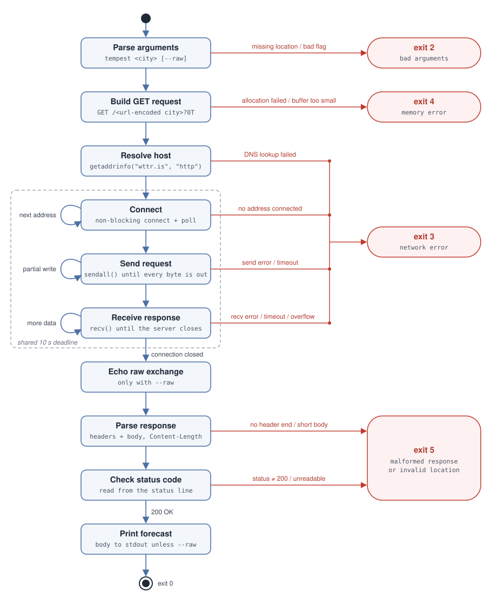

# tempest

Small learner project that allows you to get the weather in your terminal.

tempest is a tiny C program that fetches the current conditions for a city from
[wttr.is](https://wttr.is) and prints them.

```
$ ./tempest London
Weather report: London

     \  /       Partly Cloudy
   _ /"".-.     +14(11) °C
     \_(   ).   ↗ 15 km/h
     /(___(__)  10 km
                0.0 mm
```


## Usage

```
tempest <location> [--raw]
```

- `<location>`: a city or place name. Quote it if it contains spaces
  (`./tempest "New York"`). 
- `--raw`: print the HTTP request that was sent and the full response
  (status line, headers and body) instead of only the forecast. It must come
  after the location.

```
$ ./tempest London --raw
GET /London?0T HTTP/1.1
Host: wttr.is
Connection: close

HTTP/1.1 200 OK
Content-Type: text/plain; charset=utf-8
Content-Length: 155
Connection: close
...
```

The raw exchange is printed before the response is parsed, so you still see it
when the server sends back something tempest can't handle.


## Building

You need a C compiler with C23 support (GCC 13+ or recent Clang) and a POSIX
system (Linux, macOS, BSD).

```sh
make          # builds ./tempest
make clean    # removes it
```

## Implementation



## Exit codes

| Code | Meaning |
| ---- | ------- |
| 0 | Success |
| 1 | Generic error (reserved, not currently used) |
| 2 | Bad arguments (missing location, misplaced or unknown flag, too many arguments) |
| 3 | Network error (DNS failure, connect/send/receive error, timeout, response too large) |
| 4 | Memory error (allocation failed or a fixed buffer was too small) |
| 5 | Malformed response or invalid location (non-`200` status) |

Errors are printed to stderr with a `tempest:` prefix naming the function that
failed.


## License

This program is licensed under the [MIT License](LICENSE).

## Contributions

Contributions are welcome. Please submit a PR or issue on Github.

## AI usage

AI was only used to generate the implementation diagram. 

